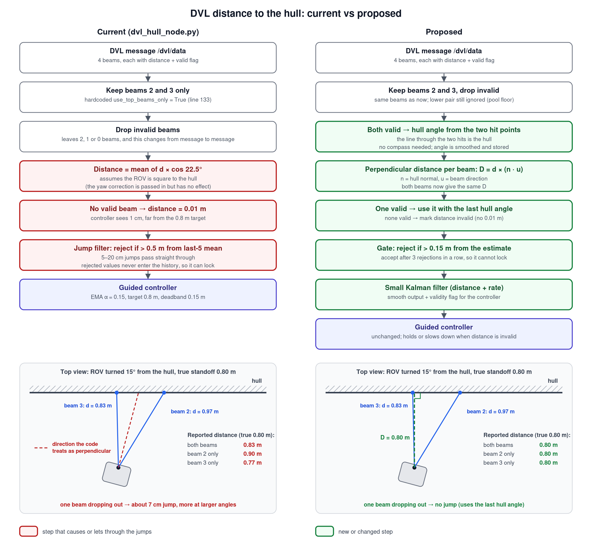
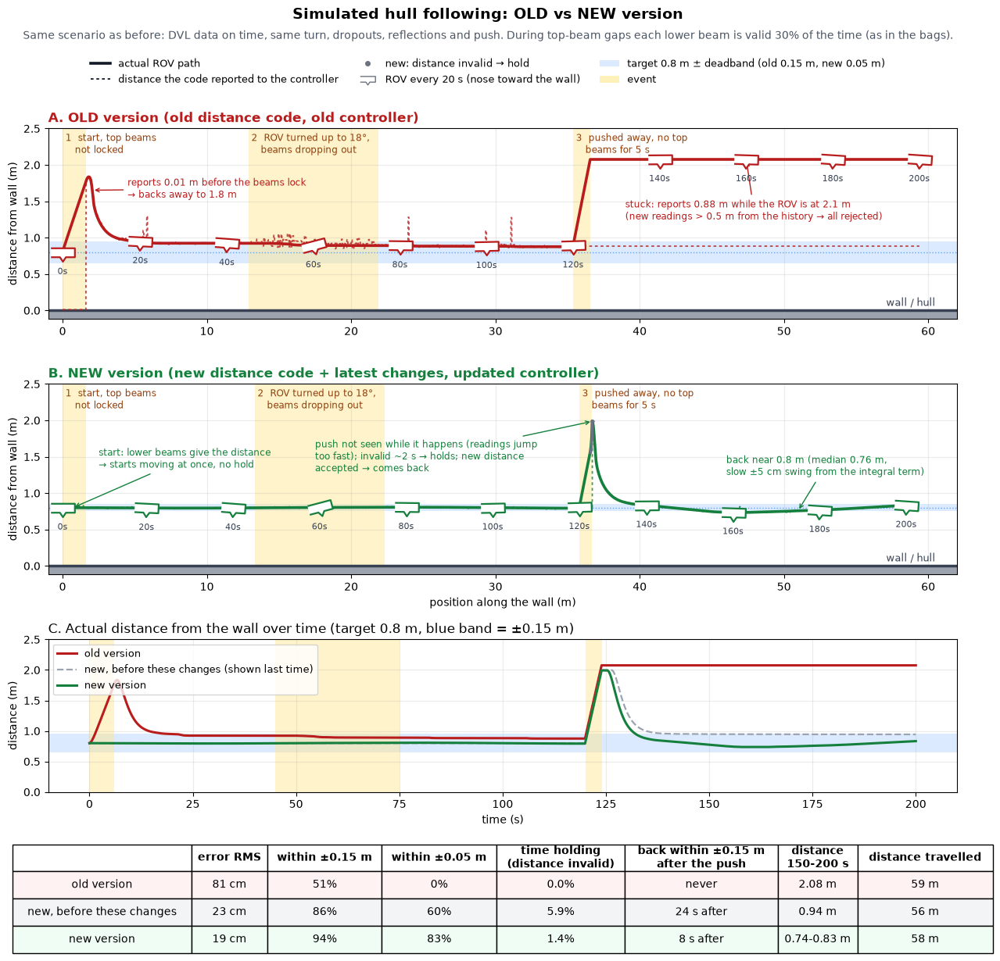
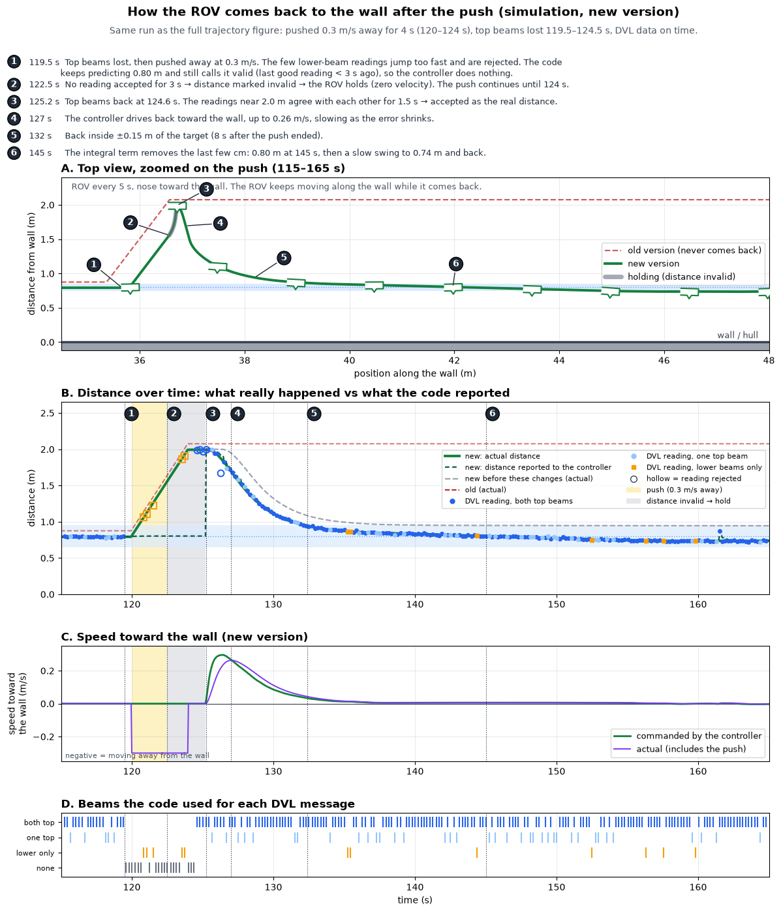

# Hull distance from the DVL: what changed



## Summary: old vs new
The old method took the distance to the hull as the average of the two top DVL beams multiplied by cos 22.5°, which is only correct when the ROV is square to the hull. When the ROV was turned and one beam dropped out, the distance jumped by 5–20 cm. Its filter only rejected changes larger than 0.5 m, so these jumps reached the controller, and after a real change larger than 0.5 m it rejected every new reading and stayed locked on the old value. With no valid beam it reported 0.01 m, which made the controller back away from the hull. The new method first measures the hull angle from the two beam hit points, then converts each beam's range into the true perpendicular distance, so losing a beam no longer causes a jump. The lower beams are used as a backup when both top beams are lost. Readings more than 15 cm from the estimate are rejected, but a change that stays consistent for 1.5 s is accepted, so the filter cannot lock. A small Kalman filter smooths the result, and after 3 s without a reading the distance is marked invalid and the controller holds still instead of acting on a false value. The controller deadband was also reduced from 0.15 to 0.05 m and a small integral term added. On the five oct3026 bags, steps larger than 5 cm dropped from 1292 to 311. In simulation, after the ROV is pushed 1.2 m away from the hull, the old method stays at 2.1 m, while the new method is back within 15 cm of the 0.8 m target 8 s after the push and settles near 0.8 m (error RMS 81 cm → 19 cm). The new method does not fix the 20–40 s delay in `/dvl/data` seen in the bags, which must be fixed in the DVL driver, and it still needs to be confirmed in a pool test.





## The problem
The distance to the hull jumped by several centimetres from one DVL message to the next.

- The distance comes only from the two top beams (`top_beam_indices = [2, 3]`).
- The old `compute_distance_2` averaged `d × cos 22.5°` over the valid top beams. That is only correct when the DVL is square to the hull. Its yaw correction rotated about the DVL boresight, so it had no effect.
- When the ROV is turned, the two beams measure different ranges. When one beam drops out, the average switches to the other beam alone. At 15° that is a jump of about 7 cm, and more at larger angles.
- `filter_distance` only rejected changes larger than 0.5 m, so these jumps passed through to the controller. Rejected values never entered its history, so after a real change of more than 0.5 m it could stay locked on the old value.
- With no valid beam the distance became 0.01 m.

## The new method (`hull_guider/core/hull_distance.py`)
1. **Both top beams valid:** the two hit points lie on the hull. The line through them gives the hull angle, without the compass. The angle is smoothed and stored.
2. **Each beam gives the true perpendicular distance:** `D = d × (n · u)`, where `n` is the hull normal and `u` is the beam direction. Both beams give the same `D`, so losing one causes no jump.
3. **One beam valid:** use it with the last hull angle.
4. **No top beam valid:** use the lower beams (0 and 1) with the last hull angle, with a larger noise.
5. **No beam valid:** keep predicting. After 3 s the distance is marked invalid; the longest gap in the oct3026 bags was 2.6 s. There is no 0.01 m fallback.
6. **Range limit:** readings at 2.9 m or more are treated as "no hull". In bag 5 the readings flatten at the DVL's 3 m limit.
7. **Gate:** reject a reading more than 0.15 m from the estimate. If rejected readings keep coming for 1.5 s and agree with each other, accept them, so the filter cannot lock. Short reflections (0.5–1 s in the bags) are not accepted.
8. **Beams disagree:** if the two top beams imply a hull angle beyond 35°, one is a reflection. Only the beam closest to the estimate is used.
9. **DVL velocity check:** the distance moved along the hull normal since the last accepted reading is summed from the DVL velocity. A rejected reading that matches that movement (and the movement is at least 0.15 m) is accepted at once. In the oct3026 bags this never triggered: the velocity was valid in only 15–47% of messages and did not correlate with the distance change. Check the velocity frame on the robot before relying on it.
10. **Smoothing:** a small Kalman filter on distance and rate. The rate decays when there has been no accepted reading for 0.5 s.

**Assumption:** the two top beams only measure the hull angle about the DVL x axis, which is the ROV yaw relative to the hull. Tilt about the other axis is assumed to be zero.

## Interface changes
- **`/hull/state` now has 5 values:** `[distance, yaw_error, nx, ny, valid]`. `valid` is 1.0 or 0.0.
- **`guided_controller`:** when `valid` is 0 it sends zero velocity and holds. It also starts its distance filter from the first real reading instead of from 0. A hull node that publishes only 4 values is treated as always valid.
- **Normal position update:** the position along the hull normal is only updated from a valid, filtered distance.
- **Logging:** the node logs the raw distance, the number of beams, the hull angle, whether the reading was rejected, and whether the distance is valid, for every DVL message.

- **`guided_controller` gains:**
  - deadband 0.15 → 0.05 m
  - new integral term `k_i` 0.01, limited to 0.1 m/s, active only within 0.3 m of the target and frozen while the distance is invalid
  - in simulation this removes the offset left by the deadband (0.94 m → 0.80 m) and by a steady 3 cm/s current, with a slow ±5 cm swing

**Tuning:**
- `gate`, `max_rejects`, `timeout`, `backup_beams` and `max_range` are set where `self.hull_dist` is created in `dvl_hull_node.py`.
- `deadband`, `k_i` and `i_max` are in `guided_controller.py`.

## Testing

**Unit tests (no ROS):**
```bash
python3 -m pytest test/test_hull_distance.py -q
```

**Replay a recorded bag (no ROS needed):** this compares the old and new distance on the real `/dvl/data`.
```bash
pip install rosbags numpy matplotlib
python3 tools/replay_dvl_bag.py /path/to/bag_folder --out replay_out
# if the bag does not store the dvl_msgs definitions:
python3 tools/replay_dvl_bag.py /path/to/bag_folder --msg-dir ~/ros2_ws/src/dvl-a50/dvl_msgs/msg
```
It prints:
- how often each top beam was valid
- the number of steps larger than 5 cm for the old and the new method
- the range of the hull angle

It also writes:
- `replay_out/replay.csv`, one row per DVL message
- `replay_out/replay.png`, the old and new distance, the hull angle, and when each beam was valid

**Live comparison on the topics (ROS 2):** runs the same comparison as the replay script while the DVL driver publishes, or while a bag plays. It only listens; it never commands the ROV.
```bash
source /opt/ros/humble/setup.bash && source ~/ros2_ws/install/setup.bash
python3 tools/live_dvl_compare.py --out live_out [--show]
```
It publishes `/hull_compare` = `[old, new, valid, hull_angle_deg, beams_used]` and writes `live_out/live.csv`. On Ctrl+C it prints the summary and writes `live_out/live.png`. Tested by playing `oct3026-1` into it: the output was identical to the bag replay started from the same message.

**Full node on a bag (ROS 2):**
- The bag must contain `/dvl/data`, `/mavros/imu/data` and `/mavros/global_position/rel_alt`.
- Do not run `guided_controller` while a real vehicle is connected.
```bash
colcon build --packages-select hull_guider && source install/setup.bash
ros2 run hull_guider dvl_hull        # terminal 1
ros2 bag play /path/to/bag_folder    # terminal 2
ros2 topic echo /hull/state          # terminal 3
```
